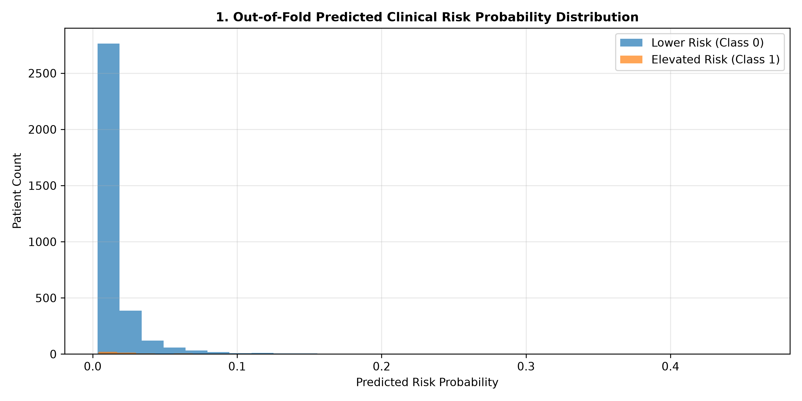
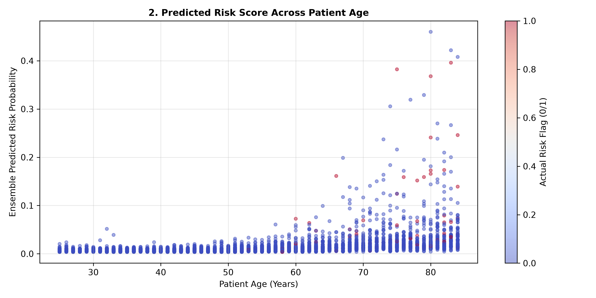
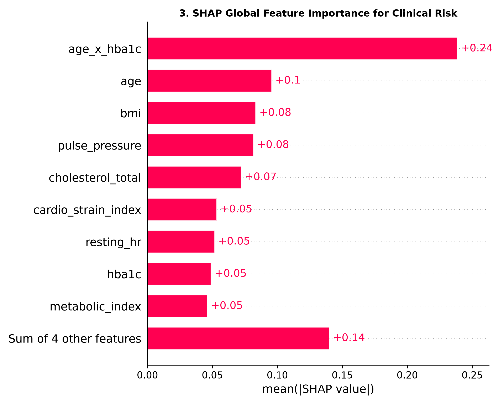

readme = """# 🩺 Clinical Health Risk Prediction Pipeline (ML & SHAP)

## Overview
An end-to-end machine learning workflow for **cardio-metabolic clinical risk stratification** using tabular patient telemetry (`age`, `BMI`, `systolic/diastolic BP`, `fasting glucose`, `HbA1c`, `cholesterol`, `resting HR`), domain physiological features (`pulse pressure`, `MAP`, `metabolic index`, `cardio strain index`), a 5-fold stratified `LightGBM` + `XGBoost` ensemble, and **SHAP** feature attribution.

## Visual Diagnostics

### 1. Risk Probability Distribution


### 2. Predicted Risk Across Patient Age


### 3. SHAP Global Feature Importance


## Quickstart
```bash
python src/health_risk_pipeline.py